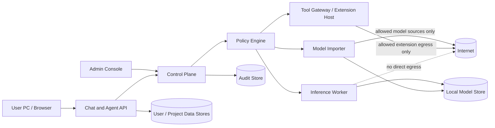
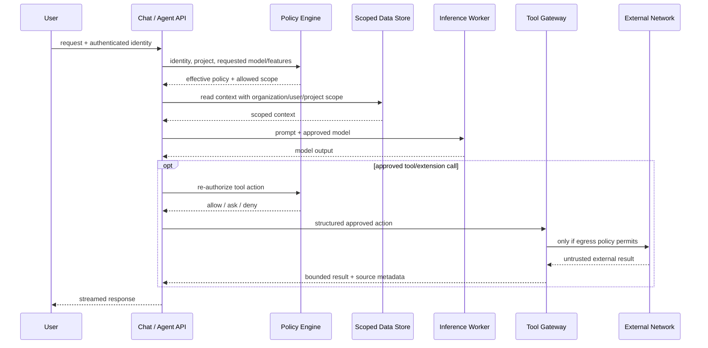

# Private AI Hub — bootstrap architecture

## 目的

Private AI Hubは、企業・組織が自社モデルまたはOSSモデルを自社サーバー上で運用することを基本とする。
外部AI Providerは必須ではなく、管理者が明示的に導入したExtensionだけを利用できる。

## 最上位ポリシー

実効能力は、少なくとも次の制約の共通部分として決定する。

1. Organization policy
2. Group / Role policy
3. Project policy
4. User request
5. Model capability / allowlist
6. Installed and enabled Extension capability
7. Network / egress policy

サーバー側の判定を正本とし、UIの表示制御だけには依存しない。

### Feature policy

機能トグルは次の3状態を基本とする。

- `disabled`: 管理者が禁止。ユーザーがONを要求しても実効値はOFF。
- `optional`: 管理者が許可。ユーザーがON/OFFを選べる。
- `required`: 管理者が強制。ユーザーがOFFを要求しても実効値はON。

数値・集合型の設定は管理者の最大値・許可集合を越えない。

## Trust boundary diagram

境界を跨ぐ要求は、呼び出し元の指定だけを信用せずPolicy Engineと所有scopeを再評価する。

## Data flow diagram

Model ImportはChat/Agent要求とは別経路で、quarantineと検査を経てModel Storeへ昇格する。

## Trust boundaries

### Control plane

- Authentication / RBAC
- Policy Engine
- Model Registry
- Audit configuration
- Rate / quota configuration
- Admin console

Control planeはユーザー要求を直接信用せず、所有主体とeffective policyを決定する。

### Chat / API plane

- conversation API
- project API
- file API
- memory API
- agent orchestration API

個人データは `organization_id + user_id`、Projectデータは `organization_id + project_id` を必須scopeとして保存・検索する。

### Inference plane

Inference Workerはモデル推論だけを担当し、標準状態では以下を持たない。

- Internet access
- arbitrary HTTP
- shell
- server filesystemの任意read/write
- Model Import用credential
- Extension credential

### Model Import plane

Model Importerだけが、管理者ポリシーで許可されたsourceからモデル取得を行う。
取得物はquarantineを経て、検査後にModel Storeへ昇格する。

Inference WorkerはImporterのnetwork権限・credentialを再利用できない。

### Extension plane

Web検索や外部Provider接続はExtension Host / Tool Gatewayを経由する。
モデル自身には直接network権限を与えない。

Extensionは以下を明示する。

- required permissions
- network destination scope
- conversation/project data scope
- filesystem scope
- rate/quota capability
- audit metadata

## 外向き通信

完全閉域では、既存ローカルモデルだけで動作できる。

制限Egress構成では外向き通信を以下に限定する。

- Model Importer
- 管理者がinstall/enableしたExtension
- 明示的に許可されたendpoint/domain

ユーザーがWeb検索をONにしても、管理者がEgressまたはExtensionを禁止していればnetwork requestは発生させない。

## データ分離

### 個人会話

所有キー:

`organization_id + user_id + conversation_id`

list/get/search/delete/export/retry等の全操作で同じscopeを強制する。

### User Memory

所有キー:

`organization_id + user_id`

vector index、embedding、cache、background jobも同じscopeを維持する。

### Project

所有キー:

`organization_id + project_id`

Project MemoryやFilesはUser Memoryと混在させない。

### Audit

Conversation Audit本文を保存する場合でも、通常のChat HistoryやUser Memoryとは別ストア・別権限として扱う。
通常のadmin roleに個人会話・User Memoryの横断閲覧権限を暗黙付与しない。

## Agent App

Agent Appは通常チャットとは別アプリとする。
Private AI HubのPolicy Engine、RBAC、Model allowlist、Memory分離、Egress、Rate Limit、Quota、Auditを必ず継承する。

Agent固有の実行場所については `agent-execution-modes.md` を正本とする。
